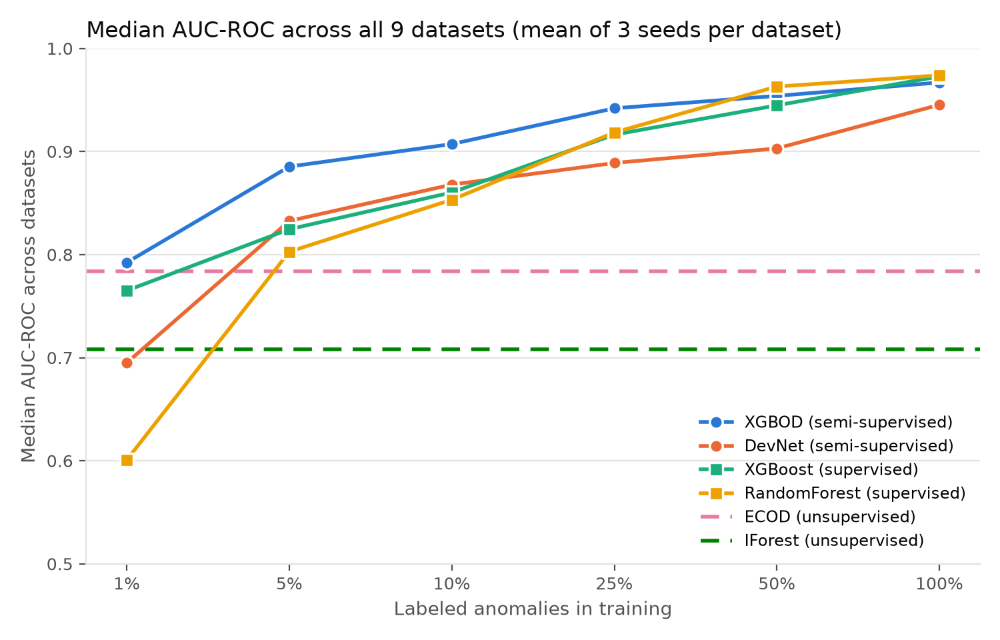
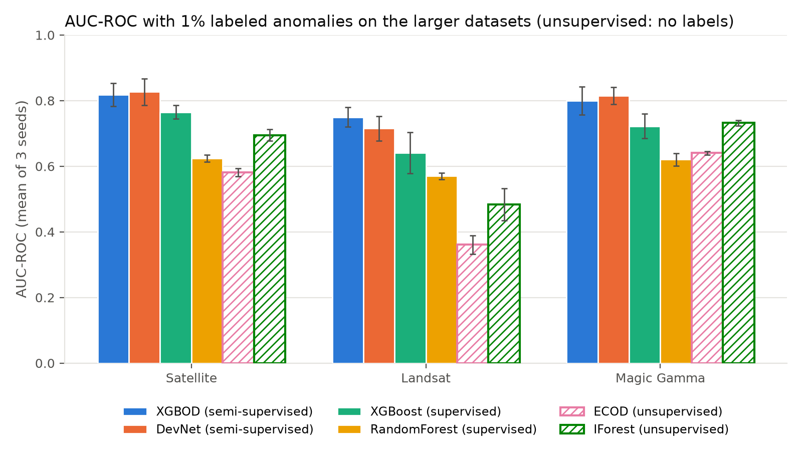
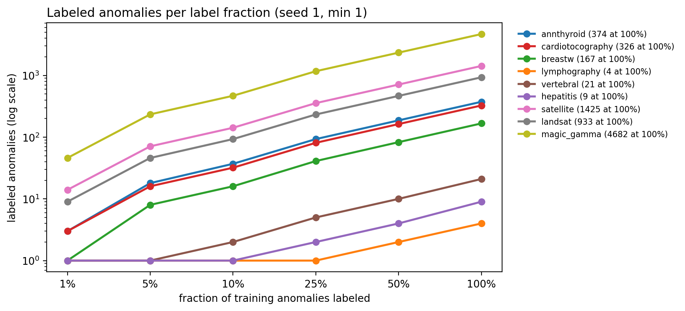

# Comparison with the paper

We replicate Angle I of ADBench (Han et al., NeurIPS 2022): how anomaly detection changes
as more anomalies are labeled. Numbers are median AUC-ROC across datasets of the mean over
3 seeds, the same summary the paper uses. All results are in `results/` and all figures are
made by `python src/plot_results.py`.

## Median AUC-ROC across all 9 datasets

| Method | Category | 1% | 5% | 10% | 25% | 50% | 100% |
|---|---|---|---|---|---|---|---|
| XGBOD | Semi-supervised | **79.2** | **88.5** | **90.7** | **94.2** | 95.4 | 96.7 |
| DevNet | Semi-supervised | 69.5 | 83.3 | 86.8 | 88.9 | 90.3 | 94.5 |
| XGBoost | Supervised | 76.5 | 82.5 | 86.0 | 91.6 | 94.5 | 97.3 |
| Random Forest | Supervised | 60.1 | 80.3 | 85.3 | 91.8 | **96.3** | **97.4** |
| ECOD | Unsupervised | 78.4 | | | | | |
| IForest | Unsupervised | 70.8 | | | | | |

## Paper's findings vs ours

| Paper's finding (Angle I) | Our result | Match |
|---|---|---|
| With 1% labeled anomalies, semi-supervised methods beat the best unsupervised method | XGBOD 79.2% vs ECOD 78.4%: holds for XGBOD, narrowly. DevNet (69.5%) does not | Yes for XGBOD |
| Semi-supervised median at 1% is about 75.6% | XGBOD 79.2%, DevNet 69.5% | Close |
| Semi-supervised methods are best at low label rates | XGBOD is the best method from 1% to 25% | Yes |
| Supervised methods need more labels to beat unsupervised ones | Random Forest is lowest at 1% (60.1%); both supervised methods pass ECOD at 5% | Yes |
| Supervised methods catch up with more labels | Random Forest is best at 50% and 100% | Yes |
| All methods converge with full labels | 94.5 to 97.4% at 100% | Yes |

## Where the 1% result comes from

Our planned experiment used 6 datasets. On those, the 1% claim did not hold: a
semi-supervised method beat the best unsupervised method on only 1 of 6 (Vertebral).
At 1%, four of those datasets give only 1 to 3 labeled anomalies. To test whether this
was the cause, we added three larger ADBench datasets (Satellite, Landsat, Magic Gamma),
where 1% gives 9 to 46 labeled anomalies. There, both semi-supervised methods beat the
best unsupervised method at 1% on every dataset and every seed.

| Datasets | Labeled anomalies at 1% | XGBOD | DevNet | Best unsupervised |
|---|---|---|---|---|
| 6 original (median) | 1 to 3 | 75.8 | 62.5 | 81.0 |
| 3 larger (median) | 9 to 46 | 80.0 | 81.5 | 69.5 |

"Best unsupervised" is the better of ECOD and IForest on each dataset.

This supports the explanation that the paper's 1% advantage depends on having enough
labeled anomalies. With only three larger datasets, other differences between the
datasets may also play a role.

## Differences from ADBench

See "Settings and hyperparameters" in the README for every setting that differs from
ADBench (scaling, labeled-count rounding, 75% fraction, resampling, subsampling).
Notes on the unsupervised baselines are in [unsupervised_baselines.md](unsupervised_baselines.md).